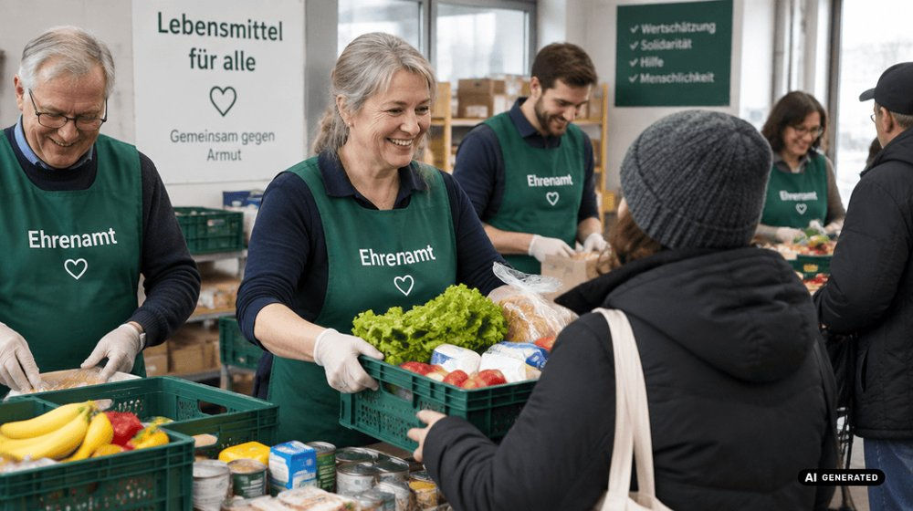
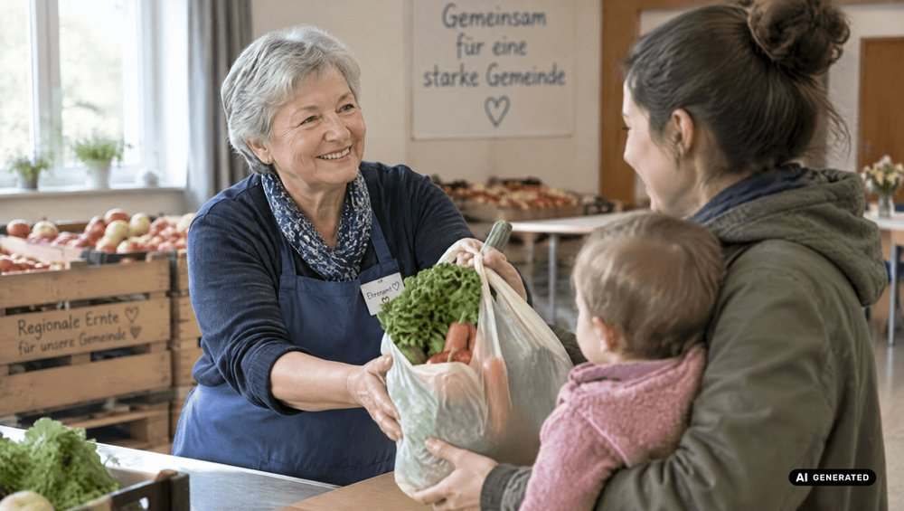
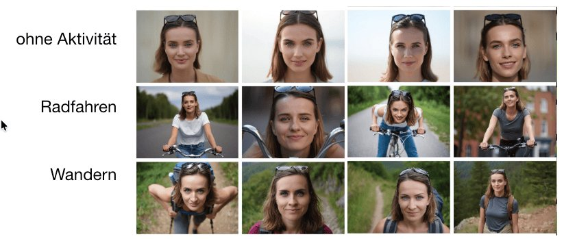
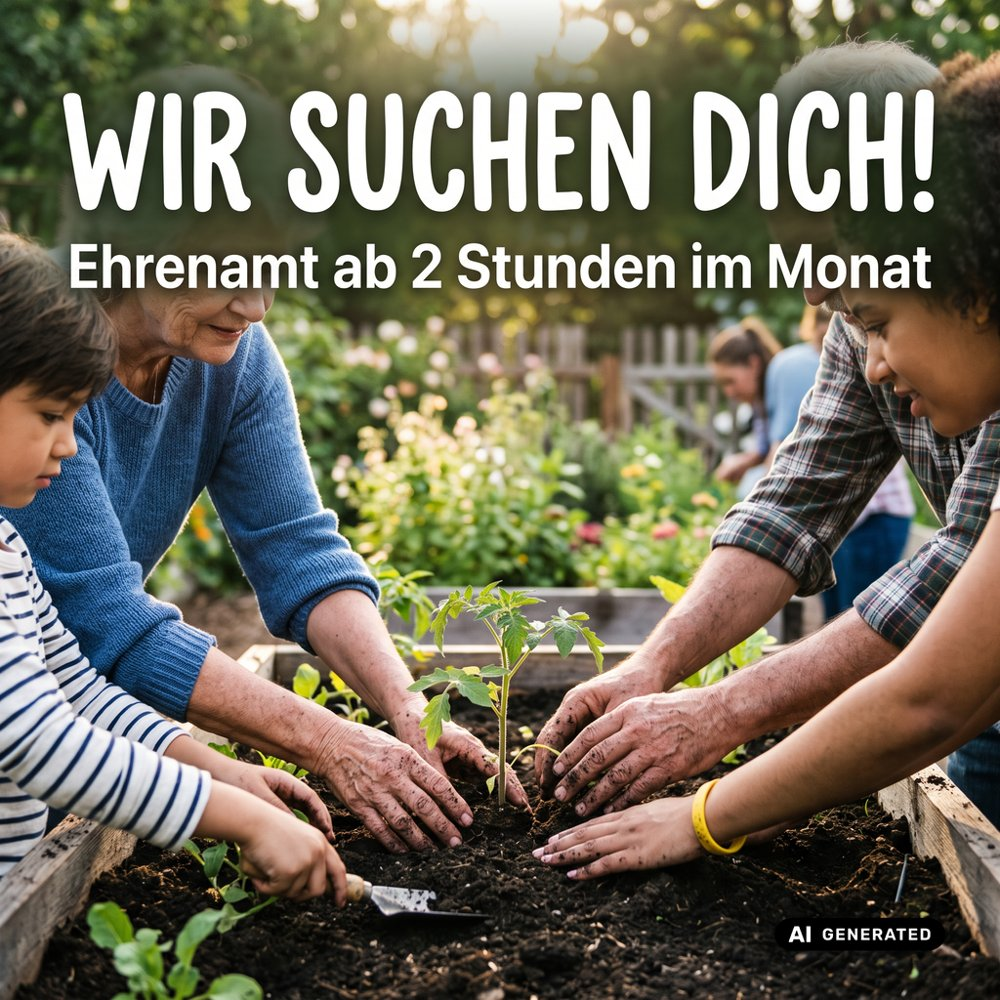
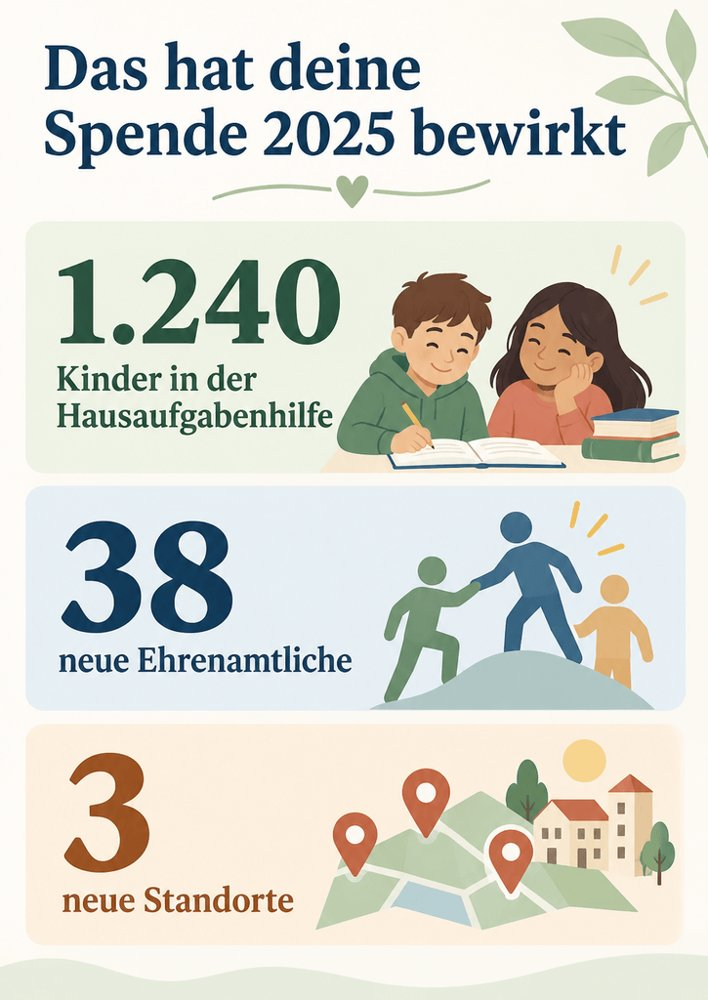
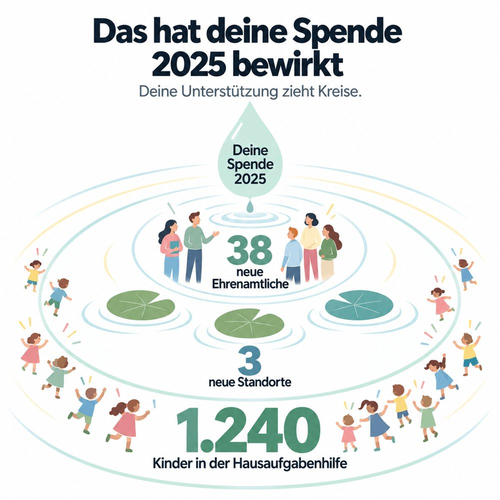
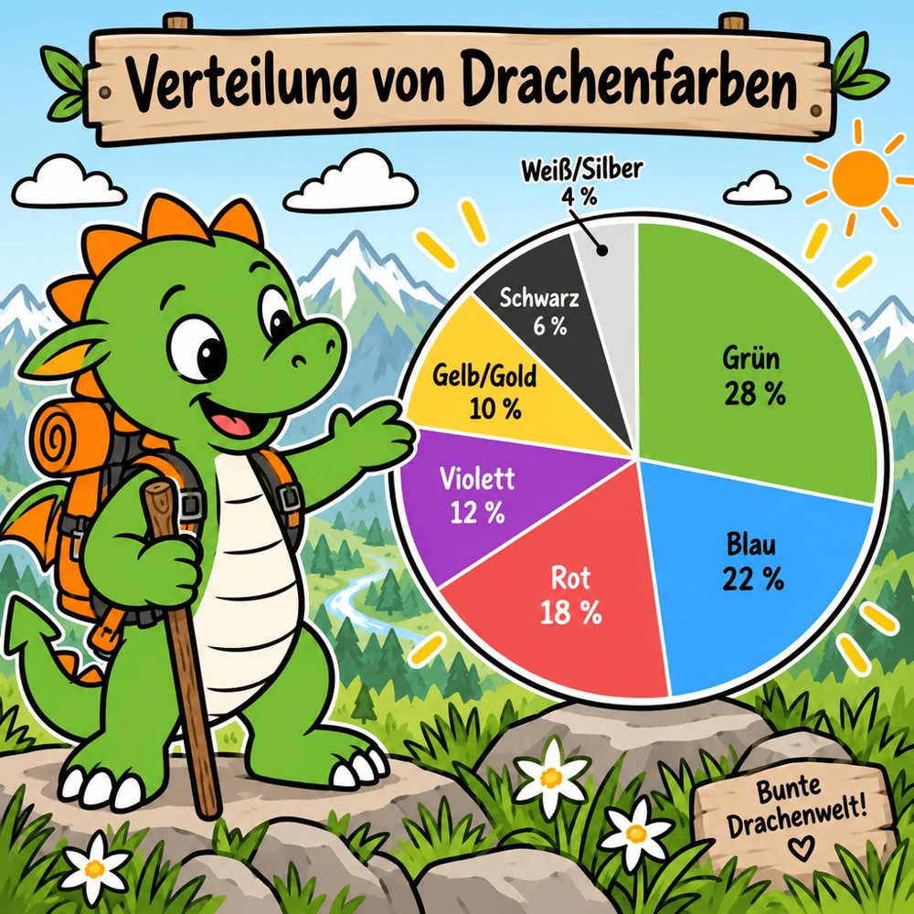
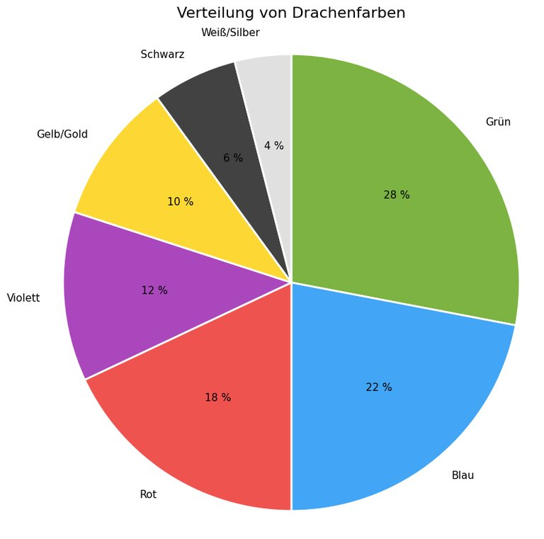
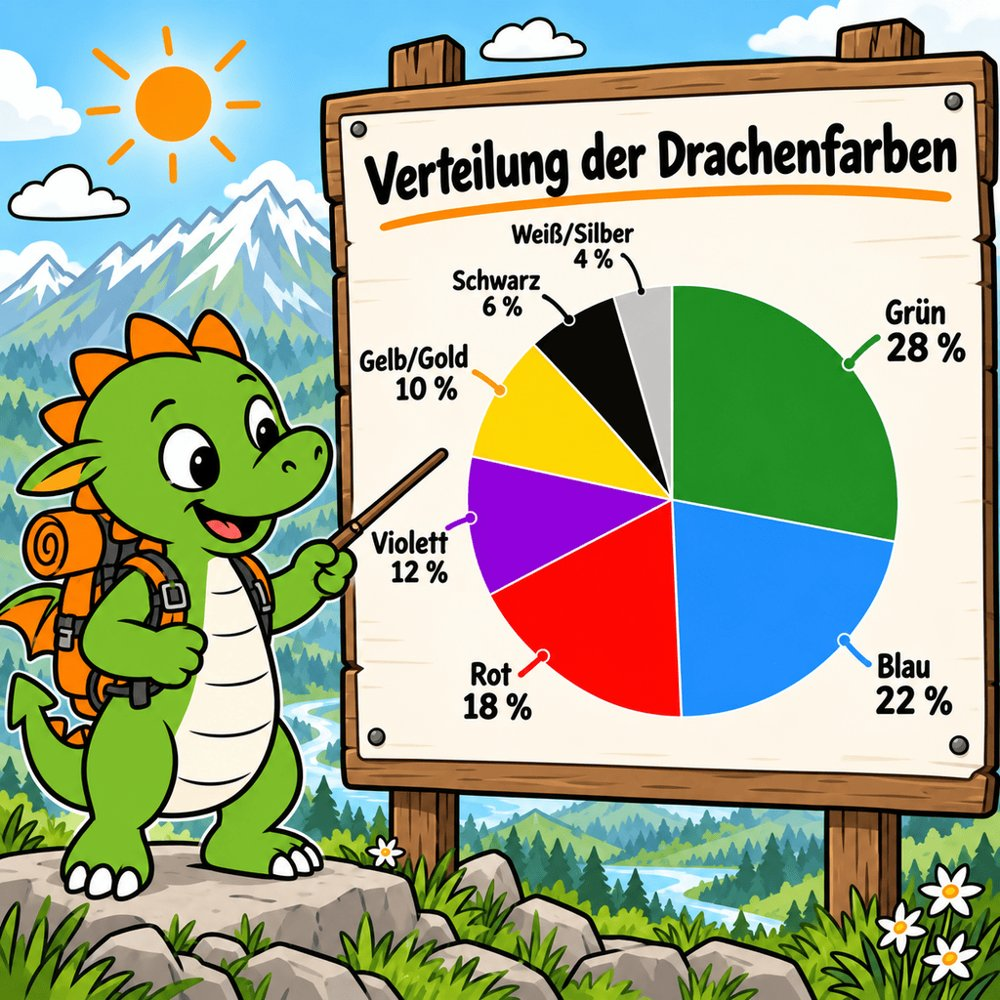
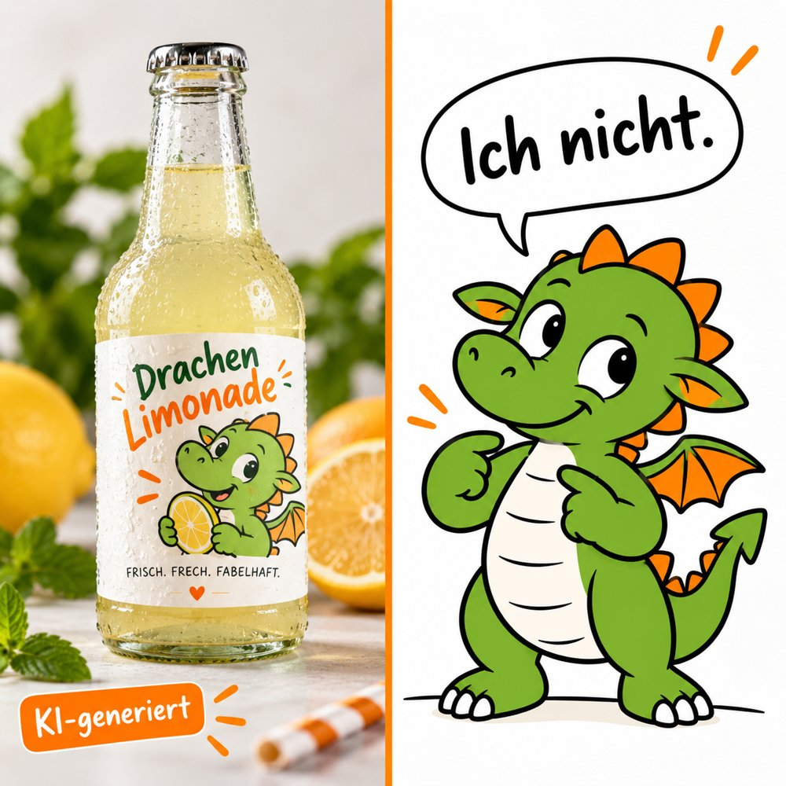

Erst denken, dann prompten: Was soll dein Bild leisten?

Frag dich vor dem ersten Prompt: Wer soll danach was fühlen, wissen oder tun? Geht es darum,

- **Gefühle zu wecken** – das Titelbild für den Spendenaufruf
- **Text durch ein Bild zu unterstützen** – das Headerbild zum Blogartikel oder die Instagram-Kachel „Ehrenamt gesucht“, die auffällt
- **Informationen zu ordnen** – die Infografik im Jahresbericht
- **Daten oder Abläufe zu zeigen** – wie sich eure Mitgliederzahlen entwickeln oder wie der Weg durch die Beratungsstelle aussieht

## Welche Tools eignen sich wofür?

<table class="tabelle">
<thead><tr><th>Bildaufgabe</th><th>Passende Tools</th><th>Stärke</th></tr></thead>
<tbody>
<tr><td>Fotorealistisch</td><td><a class="url-sichtbar" href="https://playground.bfl.ai/">FLUX.2</a>, <a class="url-sichtbar" href="https://dreamina.capcut.com/">Seedream 5.0 Pro</a>, <a class="url-sichtbar" href="https://gemini.google.com/">Nano Banana 2 / Pro</a></td><td>Menschen, realistisches Licht, glaubwürdige Szenen</td></tr>
<tr><td>Kampagnenmotiv, Plakat, Stimmungsbild</td><td><a class="url-sichtbar" href="https://www.midjourney.com/">Midjourney</a>, <a class="url-sichtbar" href="https://dreamina.capcut.com/">Seedream 5.0 Pro</a></td><td>Ästhetik, Stil, Atmosphäre, Komposition</td></tr>
<tr><td>Text im Bild bis Infografik</td><td><a class="url-sichtbar" href="https://chatgpt.com/">ChatGPT Images 2.0</a>, <a class="url-sichtbar" href="https://gemini.google.com/">Nano Banana 2 / Pro</a></td><td>Lesbare Schrift, von der Social-Media-Kachel bis zur komplexen Infografik</td></tr>
<tr><td>Daten und Abläufe</td><td>Texttools wie <a class="url-sichtbar" href="https://chatgpt.com/">ChatGPT</a>, <a class="url-sichtbar" href="https://claude.ai/">Claude</a> u. a.; für Prozesse: <a class="url-sichtbar" href="https://www.napkin.ai/">napkin.ai</a></td><td>Korrekte Diagramme, Abläufe als Grafik</td></tr>
</tbody>
</table>

Stand: September 2026

::: tipp
**Magnific** bündelt zahlreiche Bild- und Video-Modelle und deine Designvorgaben an einem Ort. Das spart den ständigen Wechsel zwischen Tools: [magnific.ai](https://magnific.ai/)
:::

## Bilder, die berühren

Starte mit drei Bausteinen und ergänze dann Details wie Licht, Perspektive und Bildausschnitt:

- **Motiv** – Wer oder was ist zu sehen?
- **Ausdruck oder Aktivität** – Was passiert? Welche Stimmung ist spürbar?
- **Stil** – fotografisch, cinematisch, editorial, malerisch, minimalistisch …

<figure>

<figcaption>Prompt: <em>Ehrenamtliche bei der Lebensmittelausgabe</em></figcaption>
</figure>
<figure>

<figcaption>Prompt: <em>Eine Ehrenamtliche Mitte 60 mit kurzen grauen Haaren reicht einer jungen Mutter eine Tüte Gemüse über den Tresen, improvisierte Essensausgabe der Tafel, Apfelkisten im Hintergrund, medium shot, soft natural light, documentary style, DSLR, shallow depth of field</em></figcaption>
</figure>

Der erste Prompt liefert ein Bild wie im Bioladen. Der zweite beginnt eine Geschichte.

<!--seitenumbruch-->

## Dein Prompt-Baukasten

Englische Fachbegriffe verstehen die meisten Tools am besten. Misch sie in deine deutschen Prompts. Nimm pro Zeile ein bis zwei Begriffe und teste, welches Stichwort den gewünschten Effekt erzielt. In immer mehr Tools kannst du auch einfach in natürlicher Sprache beschreiben, was du willst – das Tool übersetzt es dann in einen Bild-Prompt.

<table class="tabelle stichworte">
<tbody>
<tr><td>Person</td><td>Alter · Haarfarbe · Hautfarbe · (alternativ Nationalität inkl. voller Stereotyp-Ladung) · Körperform · Kleidung · Gesichtsausdruck · Hilfsmittel wie Rollstuhl oder Hörgerät</td></tr>
<tr><td>Perspektive und Winkel</td><td>close-up · medium shot · long shot · wide angle · from above · low angle (von unten, wirkt stark) · aerial shot (Vogelperspektive) · point of view (aus Sicht einer Person) · over the shoulder · profile shot · macro shot · silhouette shot · split shot (geteiltes Bild)</td></tr>
<tr><td>Format</td><td>1:1 · 3:2 · 16:9</td></tr>
<tr><td>Situation und Wetter</td><td>indoor · outdoor · early morning · rainy day · winter · in a community hall</td></tr>
<tr><td>Licht</td><td>natural light · golden hour (warm) · blue hour (kühl, mystisch) · soft lighting · hard lighting · backlighting (Gegenlicht) · side lighting (betont Texturen) · overhead lighting · window light · candlelight · backlight through fog · chiaroscuro (starke Hell-Dunkel-Kontraste)</td></tr>
<tr><td>Atmosphäre</td><td>hopeful · serene · peaceful · intimate · joyful · playful · cozy · nostalgic · dreamy · melancholic · lonely · tense · dramatic · vibrant</td></tr>
<tr><td>Für mehr Foto-Realismus</td><td>DSLR photo (oder andere Kameras) · 35 mm film · shallow depth of field (unscharfer Hintergrund) · realistic skin texture · subtle imperfections · fine grain · documentary style · cinematic lighting · balanced exposure · rim light (Lichtsaum um das Motiv)</td></tr>
<tr><td>Stil</td><td>documentary photography · editorial · watercolor · gouache · hand-drawn · flat illustration · comic style · minimalism · papercut · low poly · linocut · scribble art</td></tr>
</tbody>
</table>

- Mehr Stil-Ideen, z. B. im <a class="url-sichtbar" href="https://tianyuxu.gumroad.com/l/gptimage2">ChatGPT Guide von Tianyu Xu</a> (tianyuxu.gumroad.com)
- <a class="url-sichtbar" href="https://photos.google.com/share/AF1QipO72Hc_lU3vBZ38lLWjgaE3prQk_pyZWgPKl31Gu9b8ue-vhH5fZS50yw93KRS0Uw?key=OTM1SGxmMkJsbkE2anRNRk9rQ1p5TUdMVU12ekdn">Über 500 Stil-Vorlagen-Bilder von Rita Rassenhövel</a> (Google-Fotos-Album)

## Die Situation bestimmt den Bildausschnitt

Lass eine Frau einmal ohne Aktivität, einmal beim Radfahren und einmal beim Wandern generieren. Ohne Aktivität bekommst du meistens Gesichter, beim Wandern kommt Landschaft dazu, beim Radfahren der halbe Körper samt Lenker. Passt dir der Ausschnitt nicht, gib ihn vor.

Und: Alle Frauen sehen sich zum Verwechseln ähnlich – jung, schlank, weiß, hier brünett. KI zeigt den Durchschnitt ihrer Trainingsdaten. ==Wer Vielfalt will, muss sie beschreiben.==

## Gegen den KI-Look

Zu glatt, zu perfekt, zu generisch? Dagegen helfen sichtbare Hautporen oder Materialstrukturen, Körnung, leichte Unschärfe oder Gegenlicht – und die Begriffe aus der Zeile „Für mehr Foto-Realismus“. Oder du machst den KI-Look so ästhetisch, dass er überzeugt, wie <a class="url-sichtbar" href="https://www.linkedin.com/in/rita-rassenh%C3%B6vel-32450022a/">Rita Rassenhövel</a>, <a class="url-sichtbar" href="https://www.linkedin.com/in/stefanie-kr%C3%BCll-ai-design/">Stefanie Krüll</a> oder <a class="url-sichtbar" href="https://www.linkedin.com/in/samira-marke/">Samira Marke</a> (alle auf LinkedIn).

**Und frag dich:** Braucht dein Spendenaufruf ein fotorealistisches Bild einer Person, die es nicht gibt? Oder lohnt sich doch der Aufwand, eine Ehrenamtliche zu fragen oder eine Illustration zu nutzen?

<!--seitenumbruch-->

## Text mit Bild

Wenn das Bild einen Text begleitet (Blog, Newsletter, Pressemitteilung):

- **Metapher statt Abbild:** Für einen Artikel über Fördermittel erzählt ein Gewächshaus voller Setzlinge mehr als das hundertste Bild von Menschen am Laptop.
- **Einheitlicher Stil:** Leg einen Stil-Baustein fest, z. B. „flat illustration, pastel colours, lots of white space“, und nutze ihn für alle Beiträge.

Wenn der Text im Bild steht (Social Media, Plakat, Einladung):

- Formuliere den genauen Text und sag, wo er stehen soll.
- Beschreibe Botschaft und Emotion klar.
- Benenne, was wichtiger ist: Motiv oder Botschaft.

Beispiel-Prompt

<em>Quadratische Instagram-Kachel. Oben groß und fett: „Wir suchen dich!“ Darunter kleiner: „Ehrenamt ab 2 Stunden im Monat“. Hintergrund: Hände verschiedener Generationen bepflanzen ein Beet, weiches Morgenlicht. Die Botschaft ist wichtiger als das Motiv.</em>

## Referenzbilder, Logos und Markenfarben

Fast alle Tools können inzwischen mit Referenzbildern umgehen: Du lädst ein Bild hoch, und die KI übernimmt Stil, Komposition oder Motiv. So sehen deine Bilder über viele Beiträge hinweg einheitlich aus. Die meisten Tools verarbeiten auch hochgeladene Logos akzeptabel. Eure Markenfarben treffen sie genau, wenn du den Farbcode angibst, z. B. „Hintergrund in #2E7D32“. Welche Bilder du hochladen darfst, steht [weiter unten](#hochladen).

Zwei Workarounds, wenn Text, Logo oder Farben einfach nicht sitzen:

:::: karten

::: rahmenkarte Workaround 1
**Platz freilassen:** ==„Lass im oberen Drittel freie Fläche für Text und Logo.“== Die Fläche füllst du danach in Canva oder einem Bildprogramm.
:::

::: rahmenkarte Workaround 2
**Canva AI oder Gamma** für Rahmen und Grundlayout nutzen: Dort änderst du Text und Bild flexibel und legst fest, was in welcher Farbe und Größe erscheint. Mehr dazu: [Präsentationen mit KI erstellen](https://www.juliajunge.de/praesentationen-mit-ki-erstellen/)
:::

::::

<!--seitenumbruch-->

## Infografiken: erst Konzept, dann Bild

Eine Infografik muss ordnen, gewichten und verständlich machen. ChatGPT produziert direkt oft beeindruckende Infografiken. Bei genauem Hinsehen ist aber meist alles gleich wichtig, es fehlen Weißraum und Orientierung. Klappt es für dich nicht gut genug, starte einen neuen Chat und konzipiere erst:

::: schritte
1. ### Was ist die zentrale Aussage?
   → Hauptbild und Überschrift

2. ### Welche Infos gehören zusammen?
   → Anordnung

3. ### Was entdeckt man erst beim genaueren Hinsehen?
   → Details
:::

Beispiel-Prompt

<em>Ich brauche eine Infografik für unseren Jahresbericht: „Das hat deine Spende 2025 bewirkt“. Zielgruppe: Spender*innen 60+. Inhalte: 1.240 Kinder in der Hausaufgabenhilfe, 38 neue Ehrenamtliche, 3 neue Standorte.</em>

Oder mit dem Zusatz: <em>„Entwickle zuerst drei Konzepte. Noch kein Bild!“</em> Dann wählst du das beste Konzept aus und lässt es umsetzen.

<figure><figcaption>Direkt erzeugt</figcaption></figure>
<figure><figcaption>Nach einem Konzept</figcaption></figure>

## Wenn Daten stimmen müssen

Bei Diagrammen und Karten gilt: Bild-KI malt, sie rechnet nicht. Das gemalte Balkendiagramm sieht professionell aus – bis der Balken für 30 % länger ist als der für 40 %. Und auf der Karte mit euren Standorten liegt Hamburg an der Ostsee.

<figure><figcaption>Gemalt: Rot ist zu groß geraten</figcaption></figure>
<figure><figcaption>Berechnet: stimmt, sieht aus wie Excel</figcaption></figure>
<figure><figcaption>Kombiniert: berechnetes Diagramm als Vorlage</figcaption></figure>

- **Rechnen statt malen:** ChatGPT, Claude und Gemini können Code schreiben und selbst ausführen – je nach Tarif mit Nutzungsgrenzen. Beispiel-Prompt: *„Erstelle mit Python ein Balkendiagramm aus diesen Zahlen. Die y-Achse beginnt bei 0. Beschrifte alle Balken mit ihrem Wert.“*
- **Schreib nicht „Bild“:** Wer „Erstelle ein Bild von einem Balkendiagramm“ schreibt, landet oft beim Bildgenerator – und der malt.
- **Prüf, ob die KI gerechnet hat:** Dann ist der Code sichtbar oder aufklappbar.
- **Prüf deine Zahlen vorher:** Liest die KI Werte aus einem PDF ab, kann sie sich vertun. Dann rechnet sie korrekt – mit falschen Zahlen.
- **Als Vorlage nutzen:** Lade das korrekte Diagramm ins Bild-Tool und lass es in dein Gesamtbild einbauen. Mit Karten geht das genauso, z. B. von OpenStreetMap – nenn dann die Quelle.
- **Nachmessen:** Bild-Tools zeichnen Vorlagen neu. Dabei verrutschen oft die Proportionen.
- **Abläufe darstellen:** Dafür eignet sich [napkin.ai](https://www.napkin.ai/).

<!--seitenumbruch-->

## Muss ich das kennzeichnen?

<strong>Ja, alles Fotorealistische musst du kennzeichnen.</strong> Das verlangt Artikel 50 des EU AI Act seit dem 2. August 2026 – egal, ob das Bild einen Menschen, eine Landschaft oder eine Blume zeigt. Das gilt auch für echte Fotos, die du mit KI wesentlich veränderst, etwa wenn du Personen einfügst oder den Hintergrund austauschst.

Kennzeichne verständlich und direkt am Bild. Gratis hilft dir dabei das <a class="url-sichtbar" href="https://label.marketing-ki.de/"><strong>KI-Label Studio</strong> von Georg Neumann</a> (label.marketing-ki.de). Die EU stellt Labels zur Verfügung, eigene sind erlaubt, solange sie sofort verständlich sind.

Illustrationen musst du nicht kennzeichnen.

Achtung

<h2>Was du nicht hochladen darfst</h2>
<ul>
<li><strong>Fotos von Menschen, die nicht zugestimmt haben</strong> – und zwar der Bearbeitung mit KI. Die Foto-Erlaubnis vom Sommerfest 2020 deckt das sicher nicht ab.</li>
<li><strong>Bilder aus dem Internet</strong> – frei zugänglich heißt nicht frei nutzbar, es sei denn, es ist anders gekennzeichnet.</li>
<li><strong>Stockfotos, deren Lizenz du nicht geprüft hast</strong> – gekauft heißt nicht automatisch: mit KI veränderbar.</li>
<li><strong>Fremde Logos, Marken und bekannte Figuren</strong></li>
</ul>

<strong>Erlaubt:</strong> eigene Fotos ohne erkennbare Personen (oder mit Einwilligung der Personen zur KI-Bearbeitung), euer Logo und Bilder, an denen ihr nachweislich die Rechte habt. Außerdem KI-generierte Bilder, denn die haben kein Urheberrecht. Nutze dafür aber nur Tools, in denen du das Training mit deinen Daten abschalten kannst.

Das hier ist keine Rechtsberatung – im Zweifel frag eine*n Jurist*in.

## Zum Vertiefen

- **Mein Blogartikel:** [Bessere Bilder mit KI](https://www.juliajunge.de/bessere-bilder-mit-ki/) – alle Tipps mit mehr Beispielen
- **Kennzeichnung:** [Muss ich KI-generierte Inhalte kennzeichnen?](https://www.juliajunge.de/muss-ich-ki-generierte-inhalte-kennzeichnen/)
- **Marketing-KI Blog** – aktuelle Vergleiche und Tool-Tests, z. B. der <a class="url-sichtbar" href="https://marketing-ki.de/ki-im-einsatz/der-grosse-bild-ki-vergleich-2026-nano-banana-pro-4k-midjourney-v7-flux-2-google-imagen-4-adobe-firefly-image-5-seedream-4-5-4k-qwen-image-edit-openai-image-1-5-reve-z-image-uvm/">große Bild-KI-Vergleich</a> (marketing-ki.de, Januar 2026): 17 Generatoren lösen acht Aufgaben
- **ChatGPT Image Guide:** auf Englisch, gratis, auch für andere Tools nützlich: [tianyuxu.gumroad.com/l/gptimage2](https://tianyuxu.gumroad.com/l/gptimage2)
- **Social Hub AI Summer School:** Gratis-Aufzeichnungen, u. a. mit Georg Neumann „Nieder mit dem KI-Look“: [socialhub.io/ai-summer-school](https://socialhub.io/ai-summer-school/)
- **Bild-Tools im Detailvergleich:** [gradually.ai/bildmodelle-vergleich](https://www.gradually.ai/bildmodelle-vergleich/)

Die KI setzt um, was du beschreibst – nicht, was du meinst. Je klarer du vorher weißt, was dein Bild leisten soll, desto weniger Versuche brauchst du.

