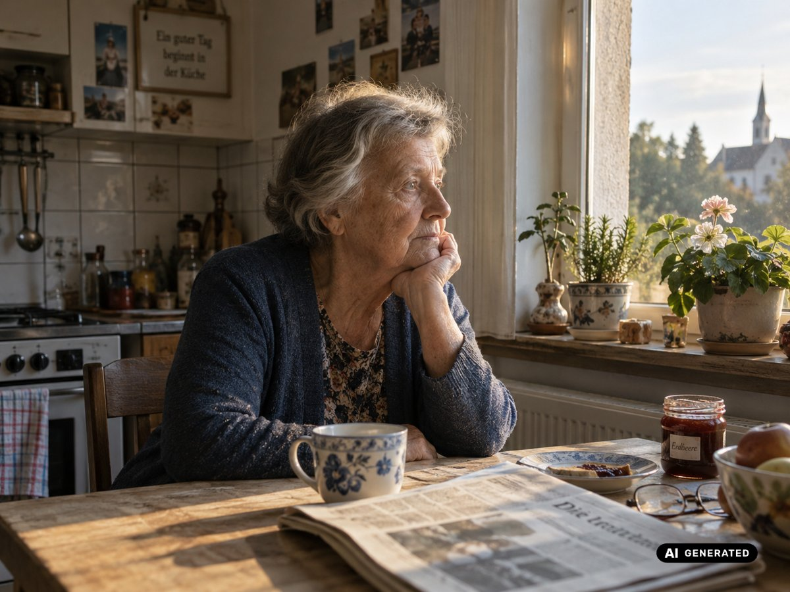
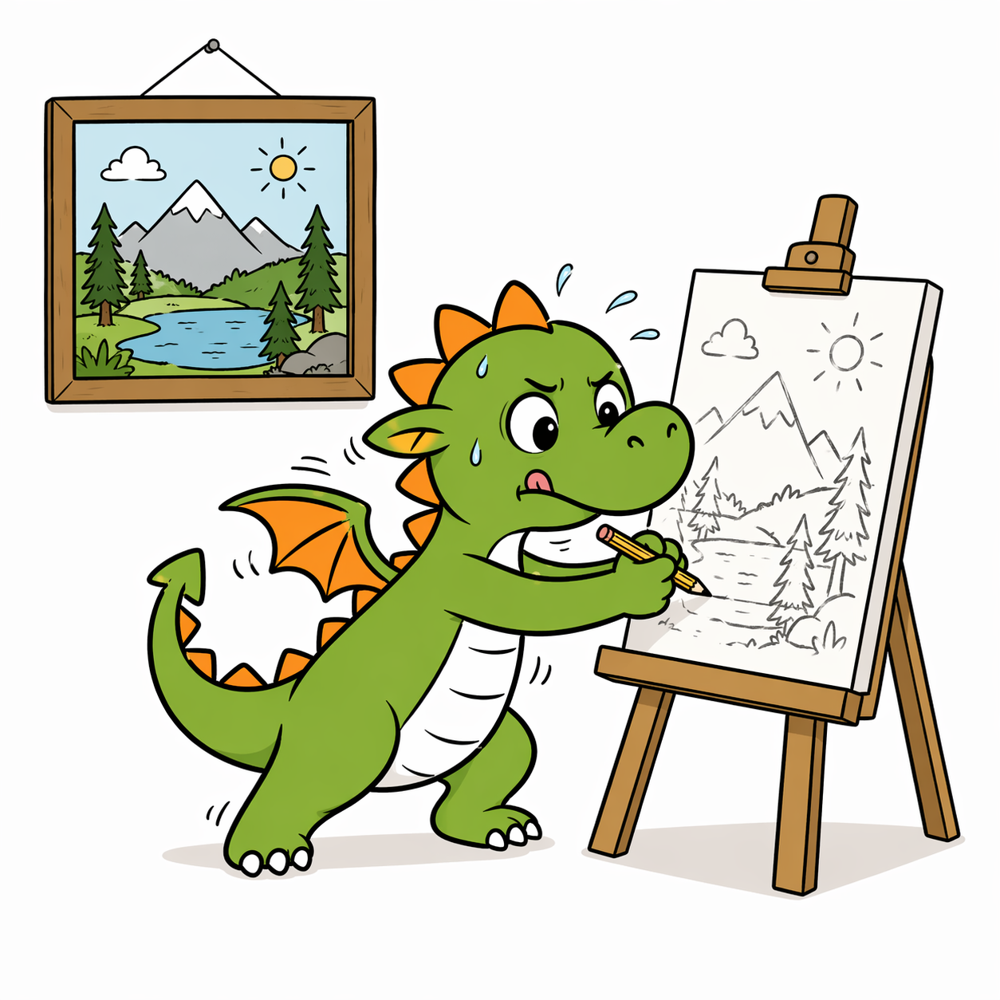
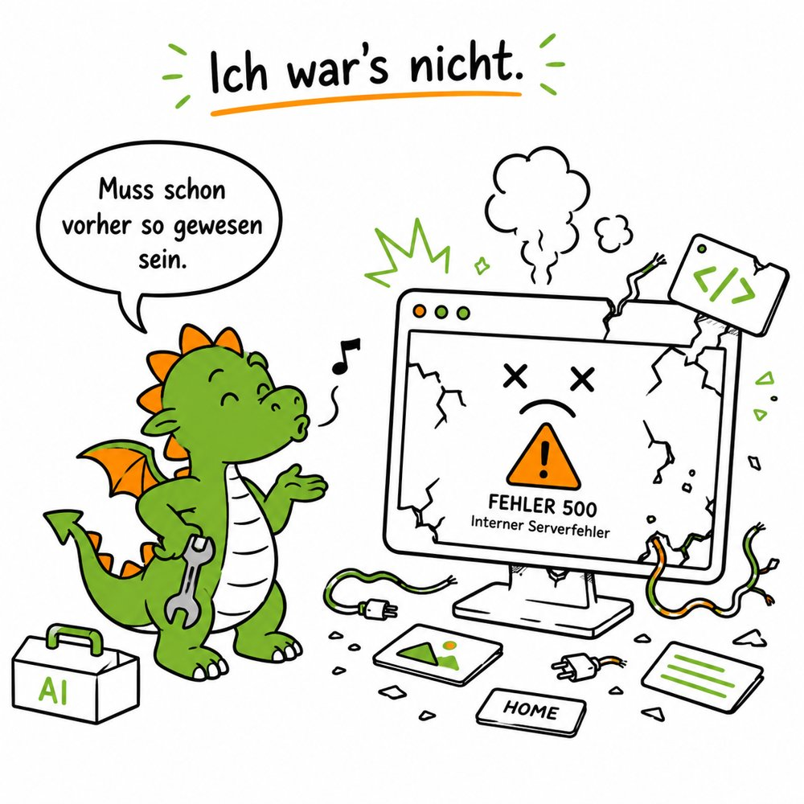
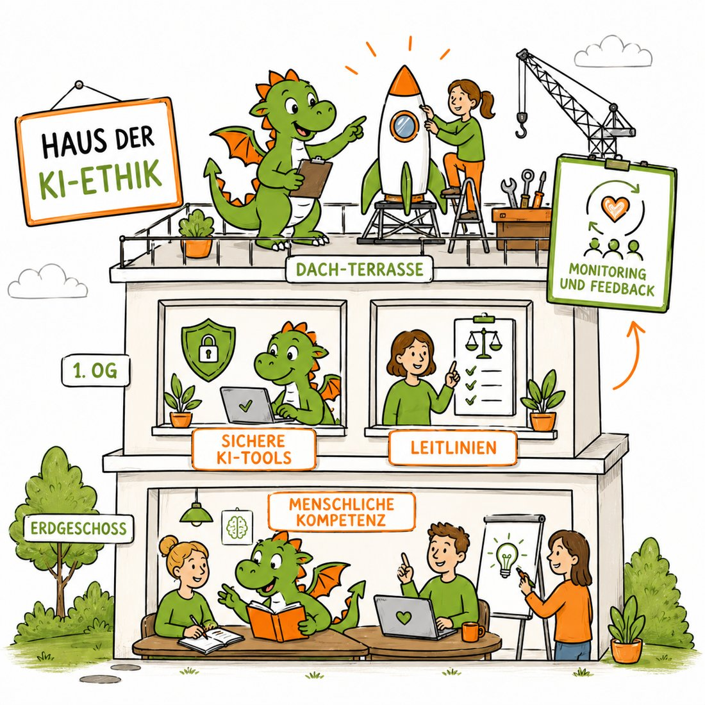

Erst denken, dann prompten: Was soll dein Bild leisten?

- Soll das Bild emotional wirken?
- Soll das Bild Text illustrieren, also unterstützen?
- Soll es Informationen transportieren, wie eine Infografik?
- Sollen Daten oder Prozesse visualisiert werden, etwa Zahlen oder Karten?

## Welche Tools eignen sich wofür?

<table class="tabelle">
<thead><tr><th>Bildaufgabe</th><th>Passende Tools</th><th>Kurz erklärt</th></tr></thead>
<tbody>
<tr><td>Fotorealistische Bilder</td><td><a class="url-sichtbar" href="https://bfl.ai/">FLUX.2</a>, <a class="url-sichtbar" href="https://dreamina.capcut.com/">Seedream 5.0 Pro</a>, <a class="url-sichtbar" href="https://gemini.google.com/">Nano Banana 2 / Pro</a></td><td>Stark für Menschen, realistisches Licht, glaubwürdige Szenen</td></tr>
<tr><td>Starke Ästhetik und Bildwirkung</td><td><a class="url-sichtbar" href="https://www.midjourney.com/">Midjourney</a>, <a class="url-sichtbar" href="https://dreamina.capcut.com/">Seedream 5.0 Pro</a></td><td>Besonders gut für Stil, Atmosphäre, Komposition und starke visuelle Wirkung</td></tr>
<tr><td>Text im Bild bis Infografik</td><td><a class="url-sichtbar" href="https://chatgpt.com/">ChatGPT Images 2.0</a>, <a class="url-sichtbar" href="https://gemini.google.com/">Nano Banana 2 / Pro</a></td><td>Gut für Schrift und textnahe Visuals bis hin zu komplexen Infografiken</td></tr>
</tbody>
</table>

::: tipp
**Magnific** bündelt zahlreiche Bild- und Video-Modelle. Das spart Wechsel und bringt Workflows, Designvorgaben und kreative Prozesse an einem Ort zusammen: [magnific.ai](https://magnific.ai/)
:::

## Emotionale und starke Bilder erzeugen

Starte mit den drei wichtigsten Bausteinen. Einige Bild-Tools bevorzugen immer noch Englisch als Prompt-Sprache. Probier es aus:

- **Akteur oder Motiv** – Wer oder was ist zu sehen?
- **Ausdruck oder Aktivität** – Was passiert? Welche Stimmung ist spürbar?
- **Stil** – fotografisch, cinematisch, editorial, malerisch, minimalistisch …
- **Ergänze Details:** Licht, Umgebung, Perspektive, Farben, Materialien, Bildausschnitt

Beispiel-Prompt

<em>Eine ältere Frau sitzt am Küchenfenster, schaut nachdenklich nach draußen, warmes Morgenlicht, dokumentarische Fotografie, ruhige Farbigkeit, sichtbare Alltagsspuren, realistische Hautstruktur.</em>

<!--seitenumbruch-->

<h2>Gegen den typischen „KI-Look“</h2>

Viele KI-Bilder wirken zu glatt, zu perfekt oder zu generisch. Dagegen helfen sichtbare Hautporen oder Materialstrukturen, Körnung, leichte Unschärfe oder Gegenlicht – und besonders bei Fotos Angaben zu Kamera, Licht und Perspektive.

In immer mehr Tools kannst du einfach in natürlicher Sprache schreiben oder sagen, was du willst. Das Tool übersetzt es dann in einen „ordentlichen“ Bild-Prompt. Willst du genauer steuern, helfen dir diese üblichen Stichworte:

<table class="tabelle stichworte">
<tbody>
<tr><td>Person</td><td>Alter · Haarfarbe · Hautfarbe · (alternativ Nationalität inkl. voller Stereotyp-Ladung) · Körperform · Kleidung · Gesichtsausdruck · Hilfsmittel wie Rollstuhl oder Hörgerät</td></tr>
<tr><td>Perspektive und Winkel</td><td>close-up · medium shot · long shot · wide angle · from above · low angle (von unten, wirkt stark) · aerial shot (Vogelperspektive) · point of view (aus Sicht einer Person) · over the shoulder · profile shot · macro shot · silhouette shot · split shot (geteiltes Bild)</td></tr>
<tr><td>Format</td><td>1:1 · 3:2 · 16:9</td></tr>
<tr><td>Situation und Wetter</td><td>indoor · outdoor · early morning · rainy day · winter · in a community hall</td></tr>
<tr><td>Licht</td><td>natural light · golden hour (warm) · blue hour (kühl, mystisch) · soft lighting · hard lighting · backlighting (Gegenlicht) · side lighting (betont Texturen) · overhead lighting · window light · candlelight · backlight through fog · chiaroscuro (starke Hell-Dunkel-Kontraste)</td></tr>
<tr><td>Atmosphäre</td><td>hopeful · serene · peaceful · intimate · joyful · playful · cozy · nostalgic · dreamy · melancholic · lonely · tense · dramatic · vibrant</td></tr>
<tr><td>Für mehr Foto-Realismus</td><td>DSLR photo (oder andere Kameras) · 35 mm film · shallow depth of field (unscharfer Hintergrund) · realistic skin texture · subtle imperfections · fine grain · documentary style · cinematic lighting · balanced exposure · rim light (Lichtsaum um das Motiv)</td></tr>
<tr><td>Stil</td><td>documentary photography · editorial · watercolor · gouache · hand-drawn · flat illustration · comic style · minimalism · papercut · low poly · linocut · scribble art</td></tr>
</tbody>
</table>

- Mehr Stil-Ideen findest du zum Beispiel im [ChatGPT Guide von Tianyu Xu](https://tianyuxu.gumroad.com/l/gptimage2)
- <a class="url-sichtbar" href="https://photos.google.com/share/AF1QipO72Hc_lU3vBZ38lLWjgaE3prQk_pyZWgPKl31Gu9b8ue-vhH5fZS50yw93KRS0Uw?key=OTM1SGxmMkJsbkE2anRNRk9rQ1p5TUdMVU12ekdn">Über 500 Stil-Vorlagen-Bilder von Rita Rassenhövel</a> (Google-Fotos-Album)

::: tipp
**Wichtig:** Mit Übung kannst du den KI-Look reduzieren – oder ihn bewusst ästhetisieren. Schau dazu mal bei <a class="url-sichtbar" href="https://www.linkedin.com/in/rita-rassenh%C3%B6vel-32450022a/">Rita Rassenhövel</a>, <a class="url-sichtbar" href="https://www.linkedin.com/in/stefanie-kr%C3%BCll-ai-design/">Stefanie Krüll</a> oder <a class="url-sichtbar" href="https://www.linkedin.com/in/samira-marke/">Samira Marke</a> auf LinkedIn.
:::

<!--seitenumbruch-->

## Text im Bild, z. B. für Social-Media-Posts

- Formuliere den genauen Text und sag, wo er stehen soll.
- Beschreibe Botschaft und Emotionalität klar.
- Benenne, was wichtiger ist: Motiv oder Botschaft.

:::: karten

::: rahmenkarte Workaround 1
**Platz für Text einplanen:** Wenn du später in Canva oder einem anderen Bild-Tool weiterarbeiten willst, gib der KI mit: ==„Lass im oberen Drittel freie Fläche für einen Textkasten und ein Logo.“== Die Fläche füllst du danach selbst. Dann sitzen Text und Logo.
:::

::: rahmenkarte Workaround 2
**Canva oder Gamma nutzen:** Wenn du Bild und Text weiter bearbeiten möchtest, sind Canva AI oder Gamma überlegen. Texte und Bilder lassen sich nachträglich ändern, Markenfarben und Hierarchien kannst du steuern.
:::

::::

## Infografiken: mehr als Text und Bild

Eine Infografik kombiniert nicht nur Text und Bilder. Sie muss ordnen, gewichten und verständlich machen. Klappt der erste Versuch nicht, starte einen neuen Chat und entwirf erst das Konzept, bevor du ein Bild erzeugst. Mach dir klar:

- Was ist die zentrale Aussage? (Key Visual, erste Überschrift)
- Welche Informationen gehören zusammen? (Anordnung)
- Was erschließt sich beim genaueren Hinsehen? (Detailinfos)

Achtung

<h2>Wenn Daten korrekt sein müssen</h2>

Sobald eine Visualisierung Daten richtig wiedergeben muss, etwa in Diagrammen oder Karten, ist besondere Vorsicht nötig. Wenn die KI Bilder direkt „malt“, stimmen die Proportionen meist nicht. Lass Diagramme deshalb per Code berechnen – dann erhältst du Excel-ähnliche Diagramme. Diese kannst du, genau wie korrekte Karten, als Vorlage nutzen und in ein Gesamtbild einbauen. Prüf aber immer nach, ob die Proportionen stimmen.

<strong>Sondertool-Tipp für Prozessdarstellungen:</strong> <a class="url-sichtbar" href="https://www.napkin.ai">napkin.ai</a>

<!--seitenumbruch-->

## Muss ich das kennzeichnen?

Das kommt darauf an. Fotorealistische Darstellungen fallen unter die Deepfake-Regelung des EU AI Act – auch wenn sie nur eine Blume zeigen. Seit August 2026 ist dann eine verständliche Kennzeichnung am Bild nötig.

Dabei hilft dir gratis das <a class="url-sichtbar" href="https://label.marketing-ki.de/"><strong>KI-Label Studio</strong> von Georg Neumann</a> (label.marketing-ki.de).

Illustrationen müssen nicht gekennzeichnet werden.

<strong>Wichtig:</strong> Geschütztes Material darfst du nicht hochladen.

## Zum Vertiefen

- **Marketing-KI Blog** – aktuelle Vergleiche, Einordnungen und Tool-Tests, z. B. der <a class="url-sichtbar" href="https://marketing-ki.de/ki-im-einsatz/der-grosse-bild-ki-vergleich-2026-nano-banana-pro-4k-midjourney-v7-flux-2-google-imagen-4-adobe-firefly-image-5-seedream-4-5-4k-qwen-image-edit-openai-image-1-5-reve-z-image-uvm/">große Bild-KI-Vergleich 2026</a> (marketing-ki.de)
- **ChatGPT Guide von Tianyu Xu:** auf Englisch, auch für andere Tools nützlich, gratis herunterladbar: [tianyuxu.gumroad.com/l/gptimage2](https://tianyuxu.gumroad.com/l/gptimage2)
- **Gratis-Webinare der Social Hub AI Summer School** (Aufzeichnungen), u. a. „Nieder mit dem KI-Look“: [socialhub.io/ai-summer-school](https://socialhub.io/ai-summer-school/)
- **Bild-Tools im Detailvergleich:** [gradually.ai/bildmodelle-vergleich](https://www.gradually.ai/bildmodelle-vergleich/)
