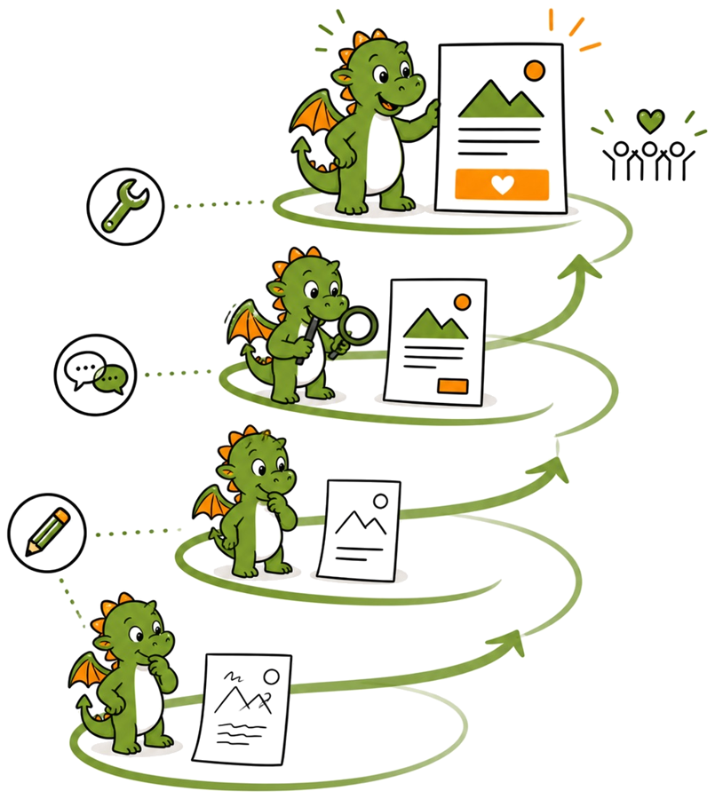
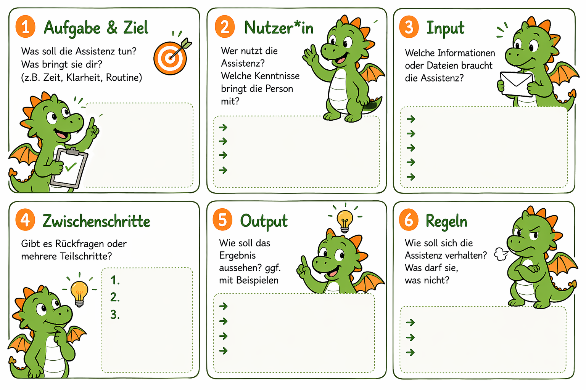

## Was sind KI-Arbeitsprofile?

:::: karten

::: karte
**Assistenzen** sind strukturierte, längere “Unterbots” mit Rollenbeschreibung, Infos, Abläufen und Rückfragen, die dir wiederkehrende Aufgaben abnehmen.

z.B.: *„Du bist Veranstaltungsplaner und hilfst, eine Checkliste zu erstellen. Frage zuerst…“*

> Assistenzen heißen in ChatGPT (Custom)GPTs, bei Gemini Gems, bei Langdock und Copilot Agenten. Sie sind in der Regel nur in kostenpflichtigen Versionen enthalten und werden zunehmend von Skills abgelöst.
:::

::: karte
**Projekte** sind meist als Ordner angelegte Bereiche in KI-Tools, in denen Dateien hochgeladen und Instruktionen gespeichert werden können.

Beispiel: Mein Projekt KI-Lernreise enthält Info-Sheets und Präsentationen und kann darauf basierend kleine Anfragen, wie Mails, Linkedin-Posts oder Konzeptfragen beantworten.

> Projekte sind im kleinen Umfang auch in kostenlosen Lizenzen verfügbar.
:::

::: karte
**Skills** sind konkrete, eher kleine Instruktionen, die für viele Arbeitsprozesse gelten (z.B. Genderregel oder Design einer Vorlage). Sie aktivieren sich selbstständig, wenn Triggerworte auftauchen. Sie werden aktuell Tool-übergreifend ausgerollt.

> Skills gibt es bei Claude und Mistral Vibe auch gratis, sonst nur in Bezahlversionen.
:::

::: rahmenkarte
**Agenten** sind komplexe Systeme, die selber Strategien entwickeln und Tools eigenständig aktiv einsetzen. NUR für Fortgeschrittene und bezahlpflichtig.

Die bekanntesten sind **ChatGPT Work** und **Claude Cowork**. Mehr dazu in meinem Blog-Artikel: [www.juliajunge.de/agentische-ki](https://www.juliajunge.de/agentische-ki)
:::

::::

## Schritt für Schritt zu eigenen Arbeitsprofilen

::: schritte untereinander
1. ### Entdecke Use Cases im Alltag
   Welche Aufgabe wiederholt sich? Was fragen Kolleg*innen dich ständig? Wo denkst du: „Das müsste mir doch KI abnehmen können…“?

2. ### Schreibe einen guten Prompt
   So konkret wie nötig, so kurz wie möglich. Benenne Rolle, Ziel und Aufgabe klar. Nutze das KLARO-Schema. Lasse dir aus guten Chats Infos für Prompts zusammenfassen. Speichere den Prompt in deinem KI-Tool als Assistenz/Skill/Projekt. ==Hilfe dafür: zwei fertige Prompts unter „Lass dir von der KI beim Prompt helfen“.==

3. ### Hinterlege Wissen und Beispiele und integriere Rückfragen
   Was braucht die Assistenz, um gut arbeiten zu können? Wenn die KI auf etwas warten oder nachfragen soll – gib das mit an.

4. ### Testen, teilen, verbessern
   Teste deinen Prompt im Alltag. Verbessere ihn. Teile ihn mit anderen. Verbessere ihn.
:::

::: tipp
**Viele gute Beispiele für Assistenz-Prompts** findet ihr bei Felix Schlenther unter [ai-first.ai/ai-assistenten](https://ai-first.ai/ai-assistenten) (Gratis-Registrierung erforderlich)
:::

<!--seitenumbruch-->

## Lass dir von der KI beim Prompt helfen

<div class="prompt-tipps"><div><h3>3 Tipps, damit es schneller geht</h3><ul><li><strong>Reden statt schreiben:</strong> Beantworte die Fragen der KI per Spracheingabe. So erzählst du von selbst mehr Details, als du tippen würdest.</li><li><strong>Frag, was fehlt:</strong> Lass dir von der KI sagen, welche 3 Infos sie braucht, um die Aufgabe zu erledigen.</li><li><strong>Nach guten Arbeitssessions zusammenfassen:</strong> Lass dir eine ausführliche Instruktion zusammenfassen. Damit kannst du neue Chats beginnen oder eine Assistenz, ein Projekt oder einen Skill einrichten.</li></ul></div></div>

Kopiere einen der beiden Prompts in einen Chat. Variante 1 hilft dir beim Start, Variante 2 macht aus einem gelungenen Chat eine Assistenz.

### Variante 1: Die KI führt dich mit 5 Fragen

```
# Leitziel
Ich will eine KI-Assistenz anlegen, z. B. einen CustomGPT oder einen Skill.

# Aufgabe
Hilf mir durch den Klärungsprozess: Was genau soll die KI-Assistenz tun, und welche Infos braucht sie oder soll sie erfragen?

# Regeln
Stelle immer nur eine Frage auf einmal. Erfrage auch nötiges Fachwissen oder biete eine Recherche an. Stelle höchstens 5 Fragen. Die letzte Frage ist, ob die KI noch etwas Besonderes wissen soll.

# Output
Erzeuge am Ende eine kopierfähige Instruktion in Raw Markdown mit höchstens 7.500 Zeichen. Mache dazu Vorschläge, welche Dokumente als Wissensbasis oder Beispiele hinterlegt werden sollten.

Bevor du startest, recherchiere im Internet aktuelle Infos dazu, was gute Assistenz-Prompts ausmacht.
```

### Variante 2: Die KI fasst einen früheren Arbeitsprozess zusammen

Nutze diesen Prompt am Ende eines Chats, in dem eine Aufgabe gut geklappt hat.

```
# Leitziel
Ich will aus diesem Chat eine KI-Assistenz machen, z. B. einen CustomGPT oder einen Skill, damit ich den Arbeitsprozess wiederholen kann.

# Aufgabe
Fasse den Arbeitsprozess in diesem Chat zusammen: Was war das Ziel? Welche Schritte haben wir gemacht? Welche Infos und Rückfragen waren nötig? Was habe ich korrigiert? Wie sah das Ergebnis aus?

# Regeln
Übernimm nur, was sich bewährt hat. Lass Umwege und verworfene Ideen weg, aber mach aus meinen Korrekturen Regeln. Wenn etwas unklar ist, stelle mir höchstens 3 Rückfragen, immer nur eine auf einmal.

# Output
Erzeuge eine kopierfähige Instruktion in Raw Markdown mit höchstens 7.500 Zeichen. Mache dazu Vorschläge, welche Dokumente als Wissensbasis oder Beispiele hinterlegt werden sollten.

Bevor du startest, recherchiere im Internet aktuelle Infos dazu, was gute Assistenz-Prompts ausmacht.
```

::: canvas
## So heißen die Funktionen in den gängigen Tools

<div class="funktionen">
<div class="funktionen-rahmen"><table class="funktionen-tabelle"><thead><tr><th scope="col">Tool</th><th scope="col">Persönliche Anweisungen <span class="kopf-zusatz">(überall gratis)</span></th><th scope="col">Projekt</th><th scope="col">Assistenz</th><th scope="col">Skills</th></tr></thead><tbody><tr><th scope="row">ChatGPT</th><td><strong>Einstellungen &gt; Personalisierung</strong></td><td><strong>Projekte</strong> <span class="kapsel kapsel--gratis">auch gratis</span><span class="info">Gratis: höchstens 5 Dateien pro Projekt</span></td><td><strong>CustomGPTs</strong><span class="info">In privaten Konten nicht mehr neu anlegbar, wird am 11.12.2026 abgeschaltet</span></td><td><strong>Skills</strong> <span class="kapsel kapsel--bezahlt">nur bezahlt</span><span class="info">Nur Business, Enterprise und Edu</span></td></tr><tr><th scope="row">Microsoft 365 Copilot (Basic) <span class="kapsel kapsel--gratis">ohne Copilot-Zusatzlizenz</span><span class="info">Was freigeschaltet ist, entscheidet die IT-Administration. Fehlt etwas, frag dort nach.</span></th><td><strong>Einstellungen &gt; Personalisierung &gt; Anpassen von Copilot</strong></td><td><strong>Notizbücher</strong></td><td><strong>Agents</strong><span class="info">Einfache Agents mit Anweisungen und Webseiten. Mit Firmendaten nur mit Lizenz oder gegen Gebühr</span></td><td><strong>Skills</strong> <span class="kapsel kapsel--angekuendigt">angekündigt</span></td></tr><tr><th scope="row">Langdock <span class="kapsel kapsel--bezahlt">nur bezahlt</span><span class="info">7 Tage Testzugang</span></th><td><strong>Kontoeinstellungen &gt; Custom Instructions</strong></td><td><strong>Projekte</strong></td><td><strong>Agenten</strong></td><td><strong>Skills</strong></td></tr><tr><th scope="row">Claude</th><td><strong>Einstellungen &gt; Konto &gt; Anweisungen</strong></td><td><strong>Projekte</strong> <span class="kapsel kapsel--gratis">auch gratis</span><span class="info">Gratis: höchstens 5 Projekte</span></td><td></td><td><strong>Skills</strong> <span class="kapsel kapsel--gratis">auch gratis</span><span class="info">Unter Anpassen &gt; Skills</span></td></tr><tr><th scope="row">Mistral Vibe</th><td><strong>Kontext &gt; Anweisungen</strong><span class="info">Memory unter Datenschutz</span></td><td><strong>Projekte</strong> <span class="kapsel kapsel--gratis">auch gratis</span><span class="info">Gratis: höchstens 2 Projekte</span></td><td></td><td><strong>Skills</strong> <span class="kapsel kapsel--gratis">auch gratis</span></td></tr></tbody></table></div>
<p class="funktionen-hinweis">Stand: Oktober 2026. Die Anbieter ändern ihre Angebote häufig.</p>
</div>
:::

::: canvas
## Canvas: So planst du deine Assistenz


:::
