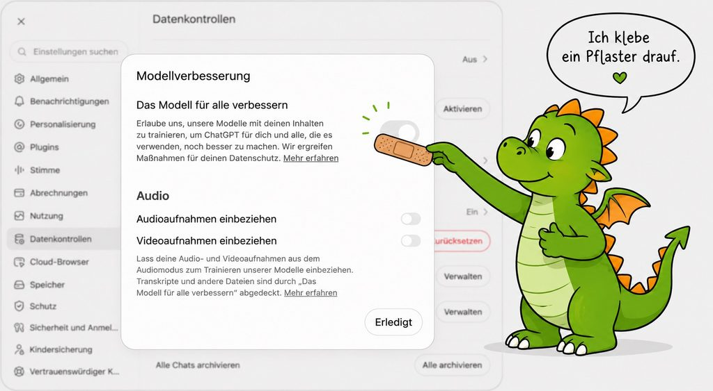

Bei ChatGPT, Claude und Mistral kannst du mit wenigen Klicks verbieten, dass deine Chats fürs KI-Training der nächsten KI-Modelle genutzt werden. Auch in den Gratisversionen. ==Kein echter Datenschutz, aber besser als nichts.==

Hier findest du die Klickpfade zum Nachmachen. Und eine ehrliche Einordnung.

## KI-Training: Was meint das?

Wichtig zum Verstehen: Die KI lernt nicht, während du mit ihr chattest. Das Modell ist fertig trainiert, es ist „eingefroren“ und dein Chat verändert daran gar nichts. Viele Anbieter möchten deine Chats aber gern sammeln, um damit ihre nächsten Modelle zu trainieren. Genau das kannst du ihnen verbieten.

Vorweg: Das Abschalten ist ein Pflaster, kein Schutz. Stell dir eine Postkarte vor, auf die du schreibst: „Bitte nicht kopieren.“ Der Anbieter hält sich vermutlich daran. Lesen kann die Karte trotzdem jede Person, durch deren Hände sie geht. Deine Chats bleiben also beim Anbieter gespeichert, auch wenn du das Training abschaltest.

Trotzdem gilt: Besser als nichts. Es dauert zwei Minuten. Also los.

Wie immer: Ich bin keine Juristin, und das hier ist keine Rechtsberatung.

## Welches Tool nutzt du?

:::: karten

::: karte ChatGPT · Gratis, Go und Plus
1. Klick links unten auf dein Profil bzw. deinen Namen.
2. Wähle **Einstellungen**.
3. Klick links auf **Datenkontrollen**.
4. Schalte „Das Modell für alle verbessern“ aus.
:::

::: karte Claude · Gratis, Pro und Max
1. Klick links unten auf dein Profil bzw. deinen Namen.
2. Wähle **Einstellungen**.
3. Klick links auf **Datenschutz**.
4. Schalte bei Präferenzen den Schalter „Help improve our AI models“ aus.

Das lohnt sich besonders: Ist der Schalter an, darf Anthropic deine Chats bis zu fünf Jahre aufbewahren. Ist er aus, gelten 30 Tage.
:::

::: karte Mistral Vibe · Gratis, Pro und Organisationen
Auch beim europäischen Anbieter ist das Training in der Gratisversion und im Pro-Tarif standardmäßig eingeschaltet. Der Schalter sitzt je nach Account an einer anderen Stelle.

**Mit eigenem Account (Free oder Pro)**

1. Klick links unten auf deinen Namen.
2. Wähle **Datenschutz**.
3. Schalte „Erlaube die Nutzung deiner Interaktionen mit Vibe zum Trainieren der KI-Modelle von Mistral“ aus.

**Für Organisationen (Admins)**

1. Klick links oben auf das Mistral-Zeichen.
2. Wähle **Admin**.
3. Geh zu **Vibe** und dann zu **Datenschutz**.
4. Schalte „Erlauben Sie die Nutzung Ihrer Interaktionen mit Vibe, um die KI-Modelle von Mistral zu trainieren“ aus.
:::

::: rahmenkarte Gemini · Sonderfall: Datenschutz nur mit Gedächtnisverlust
Bei Gemini hängen Training und Chatverlauf an einem einzigen Schalter. Wenn du verbietest, dass Google mit deinen Chats trainiert, speichert Gemini auch keinen Verlauf mehr. Du kannst also nicht zu einem früheren Chat zurückkehren und dort weiterarbeiten.

Der Schalter heißt **Gemini-Apps-Aktivitäten**. Du findest ihn in Gemini links im Menü unter **Aktivität**. Dort kannst du die Aktivität deaktivieren.

Ganz weg sind die Chats auch dann nicht sofort: Google behält eine Kopie bis zu 72 Stunden.

Gemini ohne Verlauf: Datenschutz kostet hier das Gedächtnis.
:::

::::

## Gilt für alle Tools

Bewerte Antworten nicht mit Daumen hoch oder runter. Das Gespräch kann sonst als Feedback beim Anbieter landen, auch bei ausgeschaltetem Training.

Ähnliches gilt auch bei Testmodellen oder Funktionen, die oft mit Lab oder Preview gekennzeichnet sind. Auch hier wird meist aus deiner Nutzung gelernt.

## Pflaster ≠ ausreichender Datenschutz

Der Schalter verhindert KI-Training mit deinen Daten. Er verhindert nicht, dass deine Daten gespeichert werden. Deine Chats, deine hochgeladenen Dateien und deine Benutzerdaten liegen weiter beim Anbieter, meist mindestens 30 Tage. (Übrigens auch, wenn du das Tool ohne Login nutzt!)

Bei ChatGPT, Claude und Gemini liegen sie bei US-amerikanischen Unternehmen. Für diese gilt der US Cloud Act: US-Behörden können Zugriff verlangen, auch wenn die Server in Europa stehen.

Und unabhängig vom Land: Ohne Auftragsverarbeitungsvertrag (AVV) hast du keinen vertraglichen Datenschutz für personenbezogene Daten. Die Gratisversionen UND die privaten Bezahl-Tarife (Go/Plus) bieten keinen AVV.

==Deshalb bleibt meine Faustregel: Gib nur Daten ein, die auch öffentlich werden dürften.==

Was das konkret für deine Arbeit heißt, wann du einen AVV brauchst und warum veröffentlichte Namen trotzdem geschützt sind, erkläre ich in meinem Artikel [Datenschutz und KI – 7 Merksätze für den Alltag](https://www.juliajunge.de/datenschutz-und-ki-7-merksatze/).

## Gratis mehr Datenschutz (aber ohne AVV)

Wenn du privat etwas mehr Schutz willst, ohne zu bezahlen, schau dir diese beiden Tools an:

- **duck.ai von DuckDuckGo:** Du brauchst keinen Account. duck.ai leitet deine Fragen anonymisiert an Modelle von OpenAI, Anthropic, Mistral und anderen weiter. In der Gratisversion sind das kleinere Modelle. Deine Chats werden nicht fürs Training genutzt.
- **Lumo vom Schweizer Anbieter Proton:** Lumo nutzt offene Modelle auf eigenen Servern in Europa. Keine US-Anbieter, kein Training, verschlüsselte Chats.

Aber: In den Gratisversionen gibt es keinen AVV. Für personenbezogene Daten Dritter sind sie deshalb nicht geeignet. Wenn du dir selbst aber den letzten Brief vom Finanzamt erklären lassen willst, sind sie die beste kostenlose Wahl.

## Deine 2-Minuten-Checkliste

<i class="ankreuzen"></i> Training in allen KI-Tools ausschalten, die du nutzt

<i class="ankreuzen"></i> nur eingeben, was auch öffentlich werden kann

<i class="ankreuzen"></i> für personenbezogene Daten in Job und Ehrenamt: Tarif mit AVV klären

<i class="ankreuzen"></i> Deinen Kolleg:innen diesen Artikel schicken

## Noch besser geht es im Team

Klebt eure Pflaster am besten gemeinsam im Team: Nehmt euch zehn Minuten im nächsten Meeting, klickt euch zusammen durch die Einstellungen und sprecht darüber, welche Daten in welches Tool dürfen. So wird aus einem Schalter eine gemeinsame Haltung.
