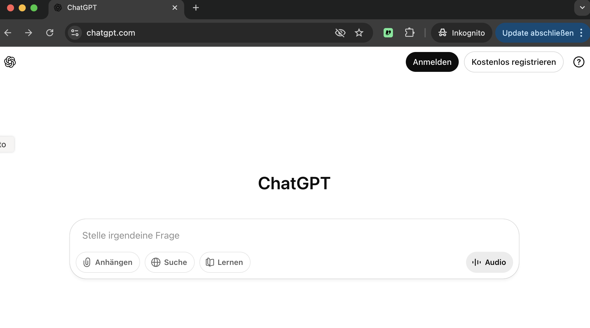
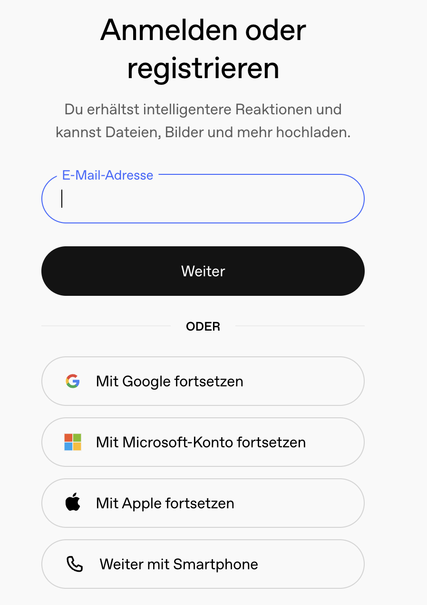
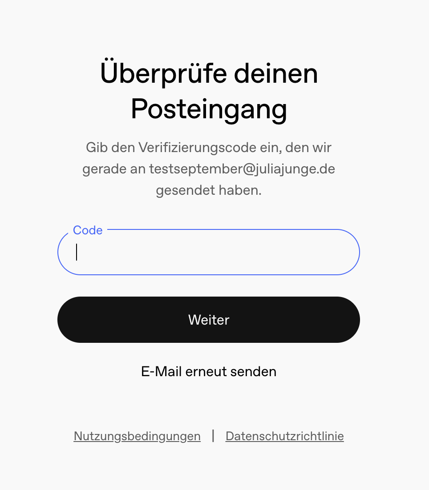
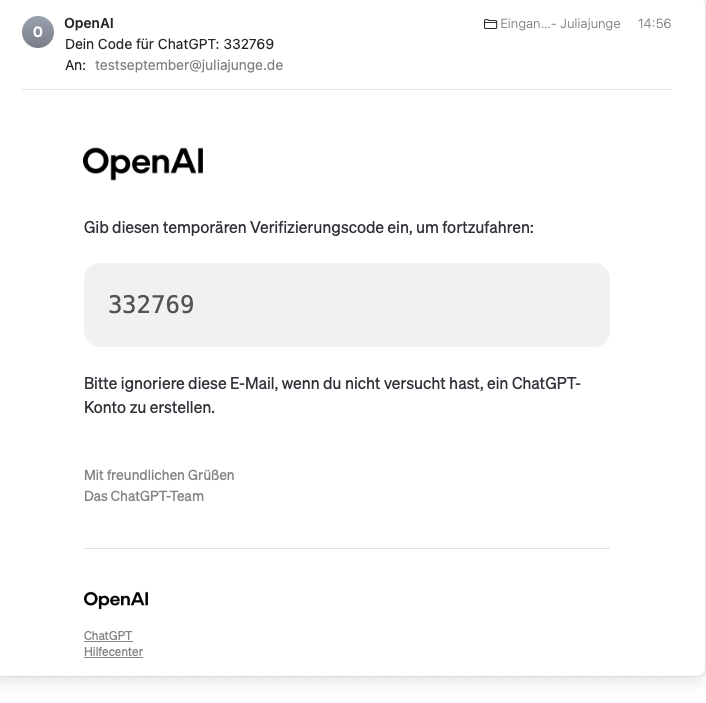
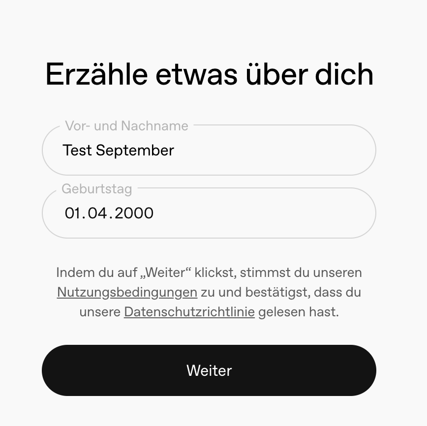
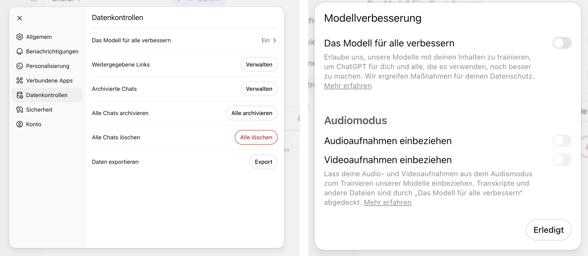
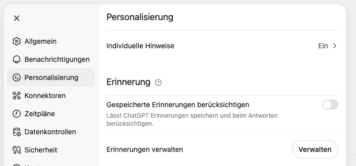
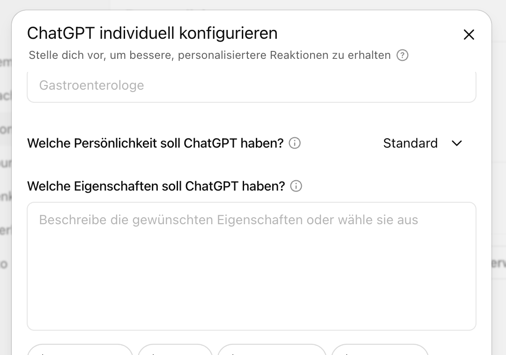

Dieses Handout führt dich Schritt für Schritt durch die **Registrierung** und die **wichtigsten Grundeinstellungen** von ChatGPT.

## Registrierung bei ChatGPT

::: schritte
1. ### Offizielle Seite öffnen
   Öffne [chatgpt.com](https://chatgpt.com) oder lade die App im Store. ==Es gibt viele Fake-Seiten== – nutze immer die offizielle. Klicke dann oben rechts auf **Kostenlos registrieren**.

   

2. ### E-Mail-Adresse eingeben
   Trag deine E-Mail-Adresse ein und klicke auf **Weiter**. Danach vergibst du ein neues **Passwort**. Möglich wäre auch ein Google-, Microsoft- oder Apple-Konto.

   

3. ### E-Mail-Adresse bestätigen
   ChatGPT schickt dir eine Mail mit einem **Code**. Trag ihn ein und klicke auf **Weiter**.

   

   

4. ### Name und Geburtstag
   Der Name darf auch ausgedacht sein. Beim Geburtstag musst du **über 18** sein. Mit **Weiter** stimmst du den Nutzungsbedingungen zu.

   
:::

## Grundeinstellungen

::: schritte
1. ### Training ausschalten
   **Profilbild → Einstellungen → Datenkontrollen → Das Modell für alle verbessern:** Schalte es ==unbedingt aus==. Dann werden deine Chats nicht zum Training künftiger Modelle verwendet. Dann **Erledigt**.

   

2. ### Erinnerungen ausschalten
   **Einstellungen → Personalisierung**, oben unter **Erinnerung**: **Gespeicherte Erinnerungen berücksichtigen**. Ich empfehle, das auszuschalten. Wenn du die Erinnerungen doch nutzt: Räum sie unter **Erinnerungen verwalten** regelmäßig auf.

   

3. ### Benutzerdefinierte Anweisungen einrichten
   **Einstellungen → Personalisierung**, weiter unten **Benutzerdefinierte Anweisungen**: Wie soll ChatGPT antworten (z. B. einfache Sprache, kritisch, mit Beispielen)? Was soll es über dich wissen (z. B. Beruf, Zielgruppe)? Das spart Zeit, weil du es nicht jedes Mal neu eingeben musst.

   Ausführliche Anleitung: [juliajunge.de/custom-instruction](https://www.juliajunge.de/custom-instruction)

   
:::

## Was ChatGPT kann

:::: karten

::: karte Suche
ChatGPT sucht bei Bedarf im Web und nennt die Quellen.
:::

::: karte Bilder
ChatGPT erstellt und bearbeitet Bilder. Im Gratis-Plan begrenzt.
:::

::: karte Projekte
Arbeitsbereiche mit eigenen Anweisungen, in denen du Hintergrundinfos in Dateien hinterlegen kannst. Im Gratis-Plan begrenzt.
:::

::: karte GPTs
Assistenzen für wiederkehrende Aufgaben. Nutzen kannst du sie kostenlos, eigene erstellen nur im Bezahl-Plan.
:::

::::

::: tipp
**Keine sensiblen Daten:** Auch mit diesen Einstellungen gehören personenbezogene Daten, z. B. von Klient\*innen oder Mitgliedern, nicht in die kostenlose Version.
:::
