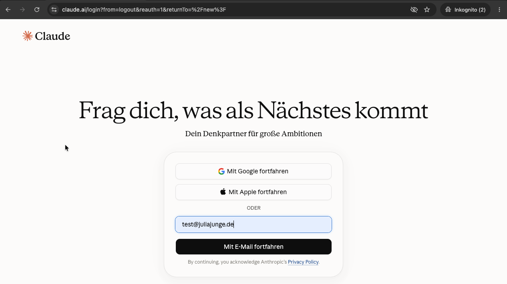
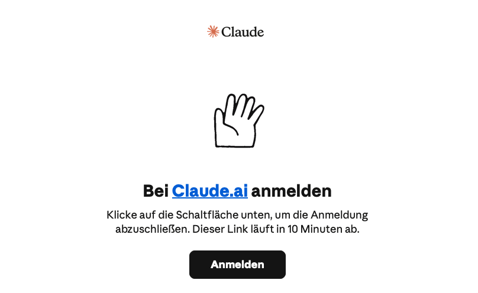
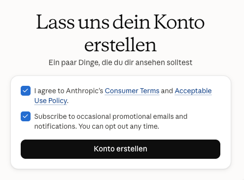
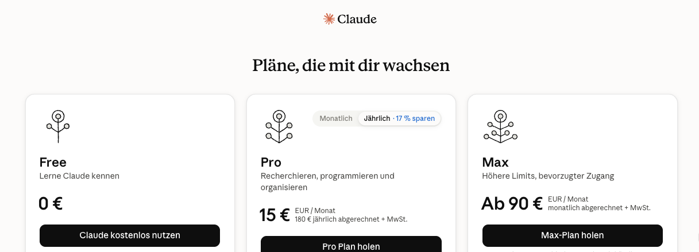
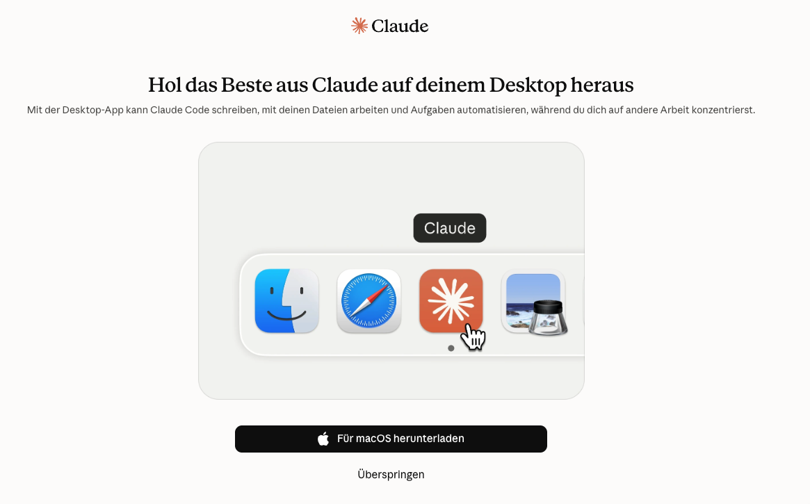
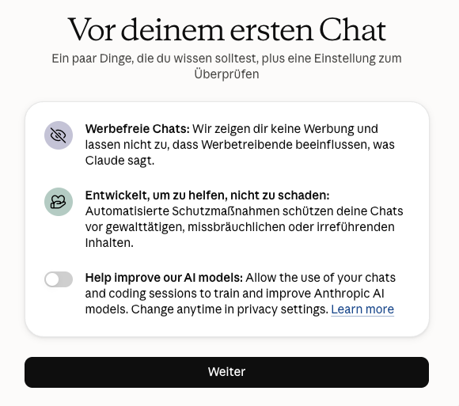
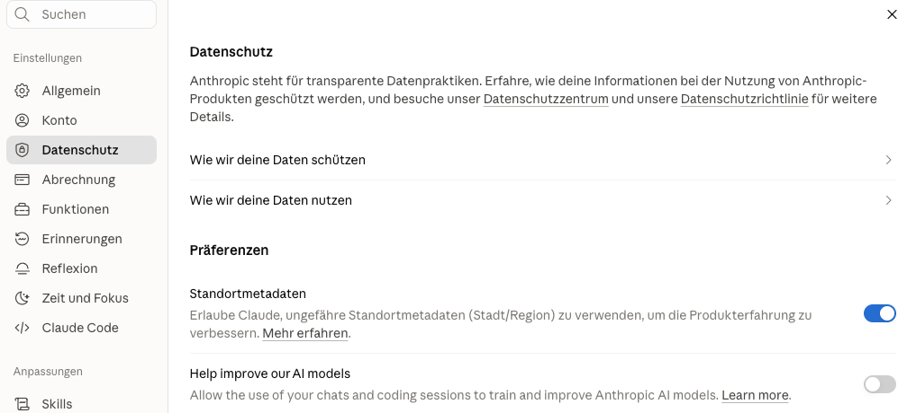
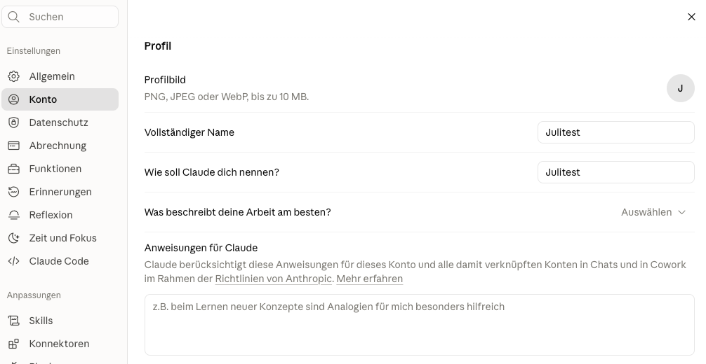

Dieses Handout führt dich Schritt für Schritt durch die **Registrierung** und die **wichtigsten Grundeinstellungen** von Claude.

## Registrierung bei Claude

::: schritte
1. ### Seite öffnen und E-Mail eingeben
   Öffne [claude.ai](https://claude.ai). Trag deine E-Mail-Adresse ein und klicke auf **Mit E-Mail fortfahren**.

   

2. ### Anmeldung per Mail bestätigen
   Du bekommst eine Mail von Claude. Klicke dort auf **Anmelden**. Der Link gilt nur 10 Minuten. Ein Passwort gibt es nicht: Du meldest dich jedes Mal über einen Link per Mail an.

   

3. ### Konto erstellen
   Nutzungsbedingungen akzeptieren. Werbe-Mails kannst du abwählen. Dann **Konto erstellen**.

   

4. ### Name und Geburtsdatum
   Der Name darf auch ausgedacht sein. Beim Geburtsdatum musst du **über 18** sein. Bei der Frage zur Personalisierung reicht **Eigenes**.

5. ### Free-Plan wählen
   Klicke auf **Claude kostenlos nutzen**. Ein Upgrade ist später jederzeit möglich.

   

6. ### Desktop-App überspringen
   Die App bitte nur nach Rücksprache mit eurer IT installieren. Klicke erst mal auf **Überspringen** – im Browser funktioniert alles.

   

7. ### Training ausschalten
   Lass den Schalter **Help improve our AI models** ==unbedingt aus==. Dann werden deine Chats nicht zum Training künftiger Modelle verwendet. Dann **Weiter**.

   
:::

## Grundeinstellungen

Die Einstellungen findest du unten links: auf deinen **Namen** klicken, dann **Einstellungen**.

::: schritte
1. ### Datenschutz kontrollieren
   **Einstellungen → Datenschutz:** Prüfe, ob **Help improve our AI models** ausgeschaltet ist.

   

2. ### Erinnerungen ausschalten
   **Einstellungen → Erinnerungen:** **Gedächtnisgenerierung aus Chats** ausschalten. So sammelt Claude keine Infos aus deinen Chats an, die du nicht im Blick hast. Was Claude immer wissen soll, schreibst du lieber selbst in die Anweisungen.

3. ### Anweisungen für Claude ausfüllen
   **Einstellungen → Konto → Anweisungen für Claude:** Hier steht, was Claude in jedem Chat über dich wissen soll, zum Beispiel:

   *„Ich arbeite in einem gemeinnützigen Verein im Bereich Jugendarbeit und bin für Öffentlichkeitsarbeit zuständig. Antworte auf Deutsch, duze mich und schreib verständlich. Frag nach, wenn dir Infos fehlen.“*

   
:::

::: tipp
**Keine sensiblen Daten:** Auch mit diesen Einstellungen gehören personenbezogene Daten, z. B. von Klient\*innen oder Mitgliedern, nicht in die kostenlose Version.
:::
