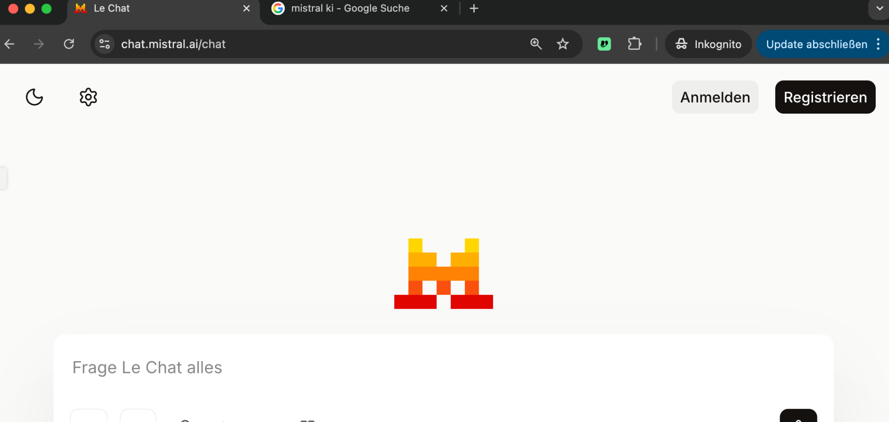
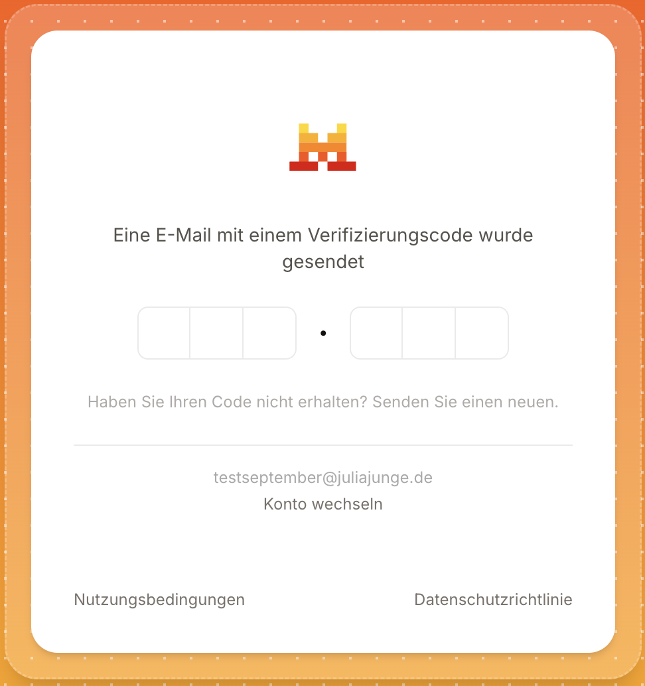
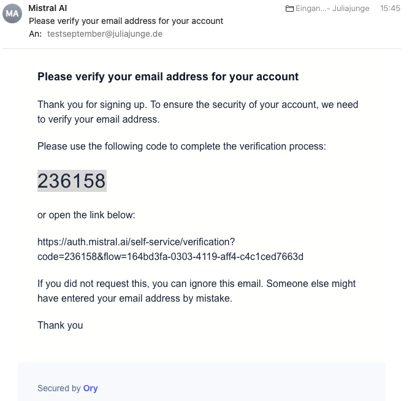
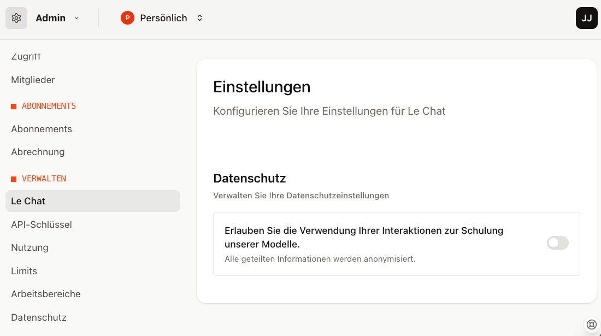
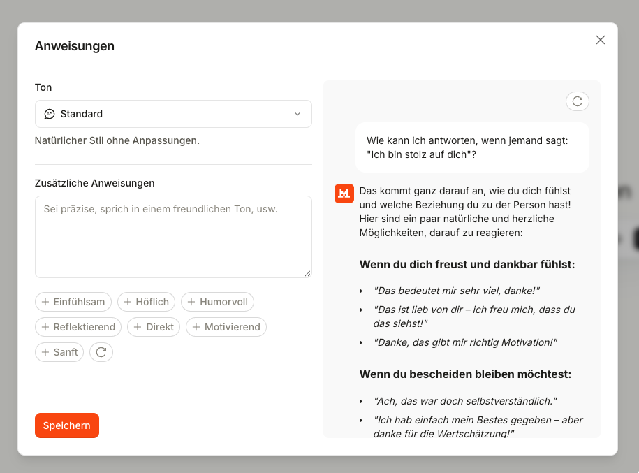
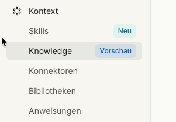

Dieses Handout führt dich Schritt für Schritt durch die **Registrierung** und die **wichtigsten Grundeinstellungen** von Le Chat, dem Chat von Mistral.

## Registrierung bei Mistral

::: schritte
1. ### Seite öffnen
   Öffne [chat.mistral.ai](https://chat.mistral.ai) und akzeptiere die **Nutzungsbedingungen**. Klicke dann oben rechts auf **Registrieren**.

   

2. ### Mit E-Mail registrieren
   Wähle die Anmeldung mit **E-Mail-Adresse**. Möglich wäre auch ein Google-, Apple- oder Microsoft-Konto.

3. ### E-Mail und Passwort vergeben
   Trag deine E-Mail-Adresse ein und vergib ein neues Passwort. Der Name ist freiwillig.

4. ### E-Mail-Adresse bestätigen
   Mistral schickt dir eine Mail mit einem **Code**. Trag ihn auf der Seite ein. Alternativ klickst du auf den Link in der Mail.

   

   
:::

## Grundeinstellungen

::: schritte
1. ### Training ausschalten
   Klicke links oben auf das **Mistral-Zeichen** → **Admin** → **Einstellungen**. Scrolle nach unten bis zum Bereich **Verwalten** und klicke auf **Le Chat**. Schalte **Erlauben Sie die Verwendung Ihrer Interaktionen zur Schulung unserer Modelle** ==unbedingt aus==. Dann werden deine Chats nicht zum Training künftiger Modelle verwendet.

   

2. ### Anweisungen einrichten
   **Kontext → Anweisungen:** Unter **Zusätzliche Anweisungen** steht, was Le Chat in jedem Chat über dich wissen soll, zum Beispiel:

   *„Ich arbeite in einem gemeinnützigen Verein im Bereich Jugendarbeit und bin für Öffentlichkeitsarbeit zuständig. Antworte auf Deutsch, duze mich und schreib verständlich. Frag nach, wenn dir Infos fehlen.“*

   Dann **Speichern**.

   

3. ### Erinnerungen ausschalten
   **Kontext → Knowledge:** Ich empfehle, die Erinnerungen auszuschalten. So sammelt Le Chat keine Infos aus deinen Chats an, die du nicht im Blick hast. Wenn du sie doch nutzt: Räum sie regelmäßig auf, damit sich kein Unsinn ansammelt.

4. ### Alles unter Kontext
   Anweisungen, Knowledge, Skills und Bibliotheken findest du links im Menü unter **Kontext**.

   
:::

## Was Le Chat kann

:::: karten

::: karte Agents
Assistenzen mit eigener Rolle, eigenen Anweisungen und eigenem Wissen, z. B. für Newsletter oder Förderanträge.
:::

::: karte Projekte
Unterarbeitsbereiche, in denen du Hintergrundinfos in Dateien hinterlegen kannst. Im Gratis-Plan begrenzt.
:::

::: karte Bibliotheken
Unter **Kontext → Bibliotheken** liegen Hintergrunddateien für deine Arbeit. Du kannst sie in Agents oder im normalen Chat nutzen.
:::

::: karte Skills
Kleine Anleitungen für wiederkehrende Aufgaben, z. B. eine Genderregel oder eine Design-Vorlage. Le Chat nutzt sie automatisch, wenn sie passen.
:::

::::

::: tipp
**Keine sensiblen Daten:** Auch mit diesen Einstellungen gehören personenbezogene Daten, z. B. von Klient\*innen oder Mitgliedern, nicht in die kostenlose Version.
:::
