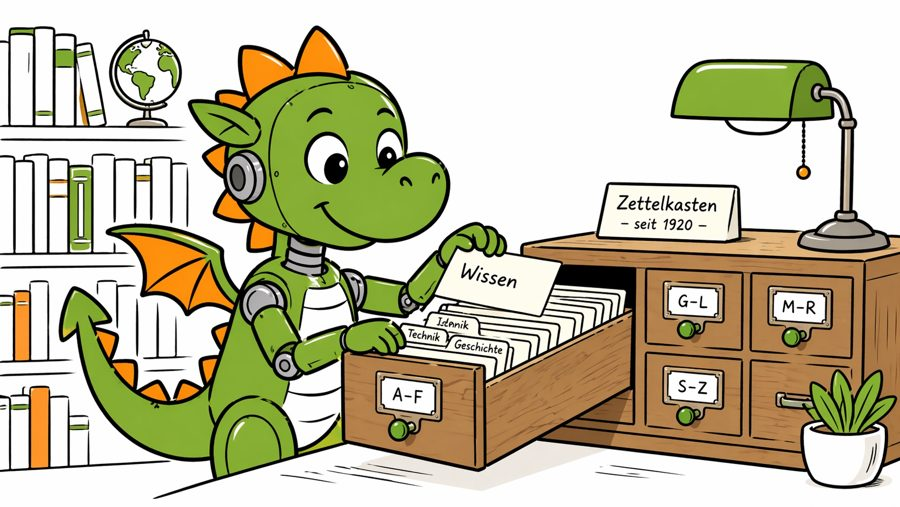

<table class="vergleich ki-arten"><thead><tr><th>Drei Arten von KI</th><th>Regelbasierte KI</th><th>Lernbasierte KI</th><th>Generative KI</th></tr></thead><tbody><tr><th scope="row">Vergleichbar mit</th><td><strong>Zettelkastenprofi</strong></td><td><strong>Bibliothekar*in</strong></td><td><strong>Professor*in</strong></td></tr><tr><th scope="row">Beispiele</th><td>ELIZA, Deep Blue</td><td>Google-Suche</td><td>ChatGPT, Mistral, Claude</td></tr><tr><th scope="row">Merkmale</th><td>Sucht nach „Wenn – dann“-Regeln</td><td>Findet bekannte Infos wieder</td><td>Erfindet Antworten aus dem Gelernten</td></tr><tr><th scope="row">Nachvollziehbar?</th><td>Ja, jede Entscheidung ist erklärbar</td><td>Bedingt, abhängig von Algorithmus und Daten</td><td>Nein, Antworten entstehen in einer „Black Box“</td></tr></tbody></table>

## 1. Was macht generative KI anders?

Generative KI wie ChatGPT ist ein **Large Language Modell (kurz LLM)**. Sie hat Millionen Texte gelesen und in Wortbruchstücke zerlegt, sogenannte Token. Diese Token wurden in Wahrscheinlichkeiten zueinander angeordnet („gewichtet“). Ein LLM erinnert sich nicht an Sätze und auch nicht an Daten hinter den Worten. Es sagt neue Sätze nur voraus, basierend auf den gelernten Wahrscheinlichkeiten der Wörter zueinander, plus ein bisschen Zufall.

## 2. KI halluziniert: Sie erfindet Antworten, auch Fakten

Generative KI „weiß“ nichts und schlägt auch nicht nach. Als prädiktive (vorhersagende) KI sagt sie Texte voraus. Das klappt sehr gut bei kurzen, oft wiederholten Infos mit klaren Wahrscheinlichkeiten: „Paris ist die Hauptstadt von … Frankreich.“ Bei komplexen oder seltenen Aussagen rät sie öfter daneben, und es klingt immer überzeugend. Das nennen wir **Halluzination**. ==Auch Quellen kann sie überzeugend erfinden.==

## 3. KI ist nicht neutral

KI lernt Verzerrungen (Bias) aus den Trainingsdaten mit. Bilder von „doctor“ zeigen weiße Männer. Menschen mit Behinderung sitzen leidend im Rollstuhl. Frauen sind jung, weiß, zu schlank und gutaussehend. Mit klaren Prompts kannst du dagegen ein Stück weit ankämpfen. Das braucht aber viel Sensibilität und Bewusstsein.

## 4. Das hilft gegen Halluzinationen

- **Relevanten Kontext liefern:** Beschreibe Kontext und Anlass. Hänge Dateien an, lass die KI danach suchen oder gib sie als Text mit.
- **Klar prompten:** Formuliere deine Fragen offen, aber präzise.
- **Nach Unsicherheiten fragen:** Bitte die KI, zu sagen, wenn sie spekuliert. Fordere von Beginn an Belege und Begründungen.
- **Schrittweise vorgehen:** Stelle eine komplexe Frage in Etappen: erst zusammenfassen, dann ausformulieren usw. („Chain of Thought“).
- **Die KI abwägen lassen:** Lass dir bewusst mehrere Antworten ausgeben und frage, welche am plausibelsten ist („Tree of Thoughts“).
- **Doppelt prüfen:** Mach bei kritischen Themen immer einen Faktencheck mit den echten Quellen.

